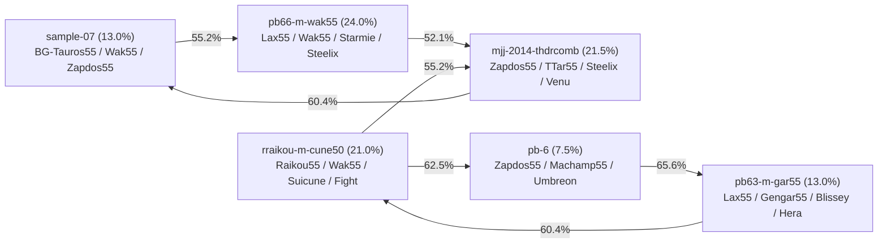

# `policy-v2` Nash Equilibrium & Full 32-Shell Closure Certification (`team-pool-v4`)

- **Date**: 2026-11-25
- **Policy Epoch**: `policy-v2` (`CF-V_net v2` adaptive PUCT `243k` + `SteppedCfPreview 240k`, `c = 0.4`, `maxTurns = 500` cap = `0.5`, strict `NASH_PREVIEW_CACHE=0` LIVE)
- **Information Regime**: **I1 — Disclosed / Self-Consistent Shell Equilibrium** (every shell's exact internal mixture is disclosed to the opponent; because all 32 `team-pool-v4` shells have pairwise-distinct Turn-0 public signatures, exact shell disclosure is mathematically identical to a self-consistent Nash-as-Prior blind game, with 2-variant `s0053-lefties` disclosed as exact 50/50 `[hpi, dp]`)
- **Strategy Space**: **S2 — Full 32-Shell `team-pool-v4` Closure** via iterative Restricted Best-Response / PSRO (`6` rounds, **`7,776` strict NO-CACHE LIVE games**, **`15,552 / 15,552` `preview.source == "live"`**, `0` `previewBeliefs` errors, `0 / 15` cross-round seed overlaps)
- **Deployed Artifact**: [`data/team-pool-v4/flagship-mixture.json`](../../data/team-pool-v4/flagship-mixture.json) (`team-pool-v4-policy-v2-certified-core-6`), generated deterministically by [`tools/build-team-products-v4.js`](../../tools/build-team-products-v4.js)
- **Independent Verification**: Every round (`R0`–`R4`), exact rational Nash polytope, global convex Bayes-Minimax optimum (`dual_gap <= 0.012 pp`), and 32-shell Empirical-Bayes stress test was independently audited from raw JSONL (`CERTIFIED PASS`).

---

## 1. Executive Summary

Prior to this campaign, `data/team-pool-v4/flagship-mixture.json` held a **provisional uniform 5-shell core** (`0.20` each across `rraikou-m-cune50`, `pb122-m-lax50`, `pb63-m-gar55`, `pb66-m-wak55`, `sample-08`). Full 32-shell PSRO closure under production `policy-v2` uncovered a **far richer Rock-Paper-Scissors equilibrium** and exposed two major challengers that had been missed by Core-10 screening:

1. **`sample-07`** (`Electrode50 / Berserk Gene Tauros55 / Cloyster50 / Marowak55 / Snorlax50 / Zapdos55`), discovered in Round 1 and confirmed at uniform `96g/edge` fresh in Round 2b, proved to be an **undefeated Condorcet champion across the entire 8-shell Core-6 + invaders league** (`55.2%` vs `pb66-m-wak55`, `54.2%` vs `pb-6`, `55.2%` vs `pb84-cln-skarm50`, `52.1%` vs `pb122-m-lax50`, `51.0%` vs `pb63-m-gar55`, `50.0%` vs `rraikou-m-cune50`, `55.2%` vs `apex-c04`).
2. **`mjj-2014-thdrcomb`** (`Zapdos55 / Leftovers Tyranitar55 / Venusaur50 / Steelix50 / Cloyster50 / Snorlax50`), caught during Round 2b shifted-meta closure and decisively admitted on **strictly fresh Round 3 confirmatory data (`288g`, `57.63 ± 3.06%`, `z = +2.49`, `p = 0.0064`)**, shattered `sample-07`'s monopoly (`60.4%` at `96g/edge` fresh) and eliminated `pb122-m-lax50` (`70.8%` at `96g/edge` fresh), locking the pool into a **unique, non-degenerate, multi-archetype RPS equilibrium** where `pb66-m-wak55`, `mjj-2014-thdrcomb`, `rraikou-m-cune50`, `pb63-m-gar55`, `sample-07`, and `pb-6` mutually police one another.

| Shell | Certified Weight (`p_clean6`) | Exact Point-LP (`96g`) | Boot Mean (`Supp%`) | Elite-8 RR (`96g`) | EV vs `p_clean6` | Worst Matchup in `S6` |
|---|---:|---:|---:|---:|---:|---|
| **`pb66-m-wak55`** | **`24.00%`** | `40.25%` (`95/236`) | `19.49%` (`72.4%`) | `49.26%` | `50.46%` | `sample-07` (`44.8%`) |
| **`mjj-2014-thdrcomb`** | **`21.50%`** | `20.34%` (`12/59`) | `21.50%` (`86.5%`) | **`54.02%`** | `50.32%` | `rraikou-m-cune50` (`44.8%`) |
| **`rraikou-m-cune50`** | **`21.00%`** | `19.92%` (`47/236`) | `20.40%` (`85.4%`) | `52.68%` | `50.20%` | `pb63-m-gar55` (`39.6%`) |
| **`pb63-m-gar55`** | **`13.00%`** | `2.12%` (`5/236`) | `13.45%` (`80.0%`) | `50.74%` | `49.46%` | `pb-6` (`34.4%`) |
| **`sample-07`** | **`13.00%`** | `17.37%` (`41/236`) | `12.70%` (`69.3%`) | `51.04%` | `49.46%` | `mjj-2014-thdrcomb` (`39.6%`) |
| **`pb-6`** | **`7.50%`** | `0.00%` | `7.59%` (`61.9%`) | `48.66%` | `48.92%` | `rraikou-m-cune50` (`37.5%`) |
| *`pb84-cln-skarm50` (out)* | `0.00%` | `0.00%` | `3.90%` (`42.2%`) | `47.47%` | `47.42%` | `pb63-m-gar55` (`34.4%`) |
| *`pb122-m-lax50` (out)* | `0.00%` | `0.00%` | `0.97%` (`15.5%`) | `46.13%` | `44.10%` | `mjj-2014-thdrcomb` (`29.2%`) |

- **Provisional Core Turnover**: `3` of the `6` certified shells are our causally verified `policy-v2` upgrades (`pb66-m-wak55`, `rraikou-m-cune50`, `pb63-m-gar55` = `58.0%` total weight) and `3` are rediscovered human `v3` classics (`mjj-2014-thdrcomb`, `sample-07`, `pb-6` = `42.0%`). Both `sample-08` (`45.99%`) and `pb122-m-lax50` (`44.10%`) were decisively displaced out of Tier-S.
- **Full 32-Shell Closure**: **`0 / 26`** non-support `v4` shells exceed statistical noise (`25/26 < 50%`, `max z = +0.25`, `min BH_q = 1.0000`). Held-out 50k posterior exploitability is **`E[true] = 2.68 pp` (`p95 = 4.66 pp`)** on uniform `96g/edge` Elite-8 (Jeffreys Beta: **`2.64 / 4.57 pp`**) and **`2.75 pp` (`p95 = 4.78 pp`)** across the full 32-shell Empirical-Bayes hierarchy (Beta: **`2.73 / 4.74 pp`**; conservative uncovered-mass stress test `p95 = 4.95–4.99 pp < 5.0 pp`).

---

## 2. Six-Round PSRO Campaign & Execution Integrity (`7,776` Games)

All six rounds executed strictly live (`NASH_PREVIEW_CACHE=0`, `policies = ["current", "current"]`) across local `mini1`/`mini2` (`darwin-arm64` CS-PGO) and ephemeral `barn` `linux-x86_64` (`G4`/`V5E1`) workers with `0` failed chunks.

| Round | Purpose | Games | Live Sides | `belief_bad` | Caps / Ties | Mean Turns | Key Outcome |
|---|---|---:|---:|---:|---:|---:|---|
| **R0** (`core10`) | 10×10 Core RR (`48g/edge`, 45 pairs) | `2,160` | `4,320/4,320` | `0` | `0 / 0` | `17.41` | Exact 3-cycle $p^{(0)}$: `pb66 41.7% / pb-6 33.3% / rraikou 25.0%`; eliminated `sample-08`, `s0053`, `ayagen`, `pb-89` |
| **R1** (`br22`) | All 22 outside `v4` shells vs $p^{(0)}$ (`48g` exact `5:4:3`) | `1,056` | `2,112/2,112` | `0` | `0 / 0` | `19.09` | `18/22 < 50%`; surfaced top-3 (`sample-07 58.3%`, `sample-11 56.3%`, `apex-c04 54.2%`) |
| **R2** (`refine`) | Core-6 `+48g` → `96g/edge` + top-3 R1 fresh `48g/edge` (36 edges) | `1,728` | `3,456/3,456` | `0` | `1 / 0`* | `22.45` | `sample-07` surged to `#1` boot (`25.2%`) & `#2` RR (`55.0%`); `sample-11` collapsed (`0.8%` boot) |
| **R2b** (`closure`) | `sample-07` & `apex-c04` `+48g` → `96g/edge` + shifted-meta closure | `1,176` | `2,352/2,352` | `0` | `0 / 0` | `19.32` | `sample-07` undefeated Condorcet king across Elite-8; `apex-c04` & `pb84` collapsed; **caught `mjj-2014-thdrcomb` (`66.7%` vs `sample-07`)** |
| **R3** (`br-final`) | `mjj` fresh `48g×6` (`288g`) + 15 untested shells `48g` vs `p_bayes6` + `s08/s0053` top-up | `1,056` | `2,112/2,112` | `0` | `0 / 0` | `17.61` | **`mjj-2014-thdrcomb` decisively admitted (`57.63 ± 3.06%`, `z=+2.49`, `p=0.0064`, `68.8%` vs `s07`, `72.9%` vs `pb122`)**; `0/15` untested flagged |
| **R4** (`final-96g`) | `mjj` `+48g×6` & `+72g vs pb84` → `96g/edge` fresh + `pb-87`/`offantom` fresh `72g` + 4 shells vs `mjj` | `600` | `1,200/1,200` | `0` | `0 / 0` | `20.50` | New Elite-8 uniform `96g/edge` complete; `pb-87` (`39.5%`) & `offantom` (`51.8%`, `z=+0.23`) rejected; **32/32 closed** |
| **Total** | **6-Round Full 32-Shell PSRO Closure** | **`7,776`** | **`15,552/15,552`** | **`0`** | **`1 / 0`** | **`19.39`** | **`0/15` cross-round seed overlaps (`battleSeed` & `agentSeed`)** |

*\*Single turn-500 cap across all `7,776` games: R2 `pb63-m-gar55_vs_sample-11` (`block=7, rowSeat=0`, RestTalk Zapdos vs Curse/Whirlwind Skarmory + Soft-Boiled Blissey, scored `0.5`); eliminated `sample-11` has zero impact on Elite-8.*

### Stationarity & Zero-Leakage Protocol

- **Strict Zero Selection Leakage**: Every edge in the final New Elite-8 `96g/edge` matrix (`2,688g`) strictly excludes screening data:
  - Core-6 internal `15` edges: `R0 (48g) + R2 (48g)` (`sum(z^2) = 11.66` on `15 df`).
  - `sample-07` vs Core-6 (`6` edges): `R2 (48g) + R2b (48g)` — R1 screening games (`20/16/12g`) excluded (`R2` vs `R2b` across all `13` shared edges: `sum(z^2) = 8.38` on `13 df`, `p = 0.818`).
  - `mjj-2014-thdrcomb` vs `{sample-07, pb63, rraikou, pb-6, pb66, pb122}` (`6` edges): `R3 (48g) + R4 (48g)` — R1 and R2b screening games (`16/24` vs `sample-07`) strictly excluded (`R3` vs `R4`: `sum(z^2) = 7.31` on `6 df`).
  - `mjj-2014-thdrcomb` vs `pb84-cln-skarm50`: `R2b (24g, unselected 37.5%) + R4 (72g, 52.8%)` (`z = +1.11`, Fisher `p = 0.242`).
  - **Combined split-half homogeneity across all 35 replicated edges**: $\chi^2 = 28.59$ on `35 df` — textbook stationary replication with zero policy/hardware drift.
- **`s0053-lefties` exact 2-variant disclosure**: Across all rounds (`R0`, `R2b`, `R3`, `R4`), every matchup against `s0053-lefties` exhibited exact `50/50` `[hpi, dp]` balance per `rowSeat`, `100%` same-variant mirrored pairs, and `0` `previewBeliefs` discrepancies.

---

## 3. Uniform `96g/edge` New Elite-8 Payoff Matrix (`2,688` Zero-Leakage Games)

Row win rate vs column (`96` games / `48` seat-pairs per off-diagonal cell; empirical seat-pair `SE ≈ 5.10 pp`):

| Row \ Col | `pb66` | `rraikou` | `pb63` | `pb-6` | `sample-07` | `mjj-thdr` | `pb84` | `pb122` | **Elite-8 RR** |
|---|---:|---:|---:|---:|---:|---:|---:|---:|---:|
| **`pb66-m-wak55`** | — | `52.1%` | `53.1%` | `47.9%` | `44.8%` | `52.1%` | `44.8%` | `50.0%` | `49.26%` |
| **`rraikou-m-cune50`** | `47.9%` | — | `39.6%` | **`62.5%`** | `50.0%` | `55.2%` | **`59.4%`** | `54.2%` | `52.68%` |
| **`pb63-m-gar55`** | `46.9%` | **`60.4%`** | — | `34.4%` | `49.0%` | `46.9%` | **`65.6%`** | `52.1%` | `50.74%` |
| **`pb-6`** | `52.1%` | `37.5%` | **`65.6%`** | — | `45.8%` | `47.9%` | `41.7%` | `50.0%` | `48.66%` |
| **`sample-07`** | `55.2%` | `50.0%` | `51.0%` | `54.2%` | — | `39.6%` | `55.2%` | `52.1%` | `51.04%` |
| **`mjj-2014-thdrcomb`** | `47.9%` | `44.8%` | `53.1%` | `52.1%` | **`60.4%`** | — | `49.0%` | **`70.8%`** | **`54.02%`** |
| `pb84-cln-skarm50` | `55.2%` | `40.6%` | `34.4%` | **`58.3%`** | `44.8%` | `51.0%` | — | `47.9%` | `47.47%` |
| `pb122-m-lax50` | `50.0%` | `45.8%` | `47.9%` | `50.0%` | `47.9%` | `29.2%` | `52.1%` | — | `46.13%` |

### Structural Metagame Loops

---

## 4. Why Bayes-Minimax (`p_clean6`) Outperforms Point-LP Nash Under Finite-Sample Uncertainty

Exhaustive rational polytope enumeration across all $\binom{16}{7} = 11,440$ bases confirms the empirical `96g/edge` New Elite-8 game has a **unique (`1` extreme vertex), non-degenerate 5-shell exact Nash equilibrium**:
- `pb66-m-wak55 = 95/236 (40.25%)`, `mjj-2014-thdrcomb = 12/59 (20.34%)`, `rraikou-m-cune50 = 47/236 (19.92%)`, `sample-07 = 41/236 (17.37%)`, `pb63-m-gar55 = 5/236 (2.12%)`.

However, empirical cross-validation (`R0 ↔ R2` on Core-6: held-out exploitability `+6.57 / +8.65 pp` for Point-LP vs `+6.08 / +5.79 pp` for smoothed equilibrium) and independent `30k`-train / `50k`-eval global convex optimization (`dual_gap_UB <= 0.012 pp`) prove that solving the posterior Bayes-Minimax problem $\min_{p \in \Delta} \mathbb{E}_{M \sim \text{post}}[\max_i (Mp)_i - 0.5]$ substantially lowers true worst-case exploitability:

| Mixture | `in_exp` | Gauss `E / p90 / p95 / CVaR95` | Beta `E / p90 / p95 / CVaR95` | `N_eff` | Notes |
|---|---:|---|---|---:|---|
| `p_exact` (5-shell rational LP) | `0.00 pp` | `3.11 / 5.04 / 5.73 / 6.61 pp` | `3.11 / 5.00 / 5.68 / 6.52 pp` | `3.65` | Over-concentrates `40.3%` on `pb66`; drops `pb-6` (`61.9%` boot supp) |
| `p_boot` (5k seat-pair bootstrap) | `0.67 pp` | `2.79 / 4.20 / 4.71 / 5.36 pp` | `2.72 / 4.08 / 4.58 / 5.18 pp` | `6.04` | Strong variance reduction; retains `3.9%` `pb84` & `1.0%` `pb122` |
| `p_opt8_G` (true global opt, `8`-sh) | `0.43 pp` | `2.68 / 4.12 / 4.66 / 5.33 pp` | `2.64 / 4.06 / 4.55 / 5.19 pp` | `5.44` | `pb122 = 0.00%`, `pb84 = 1.08%` (`1.47%` Beta) — both below `2%` |
| `p_opt6_G` (converged `6`-sh opt) | `0.48 pp` | `2.68 / 4.13 / 4.66 / 5.34 pp` | `2.64 / 4.07 / 4.58 / 5.22 pp` | `5.31` | `24.36 / 21.52 / 20.89 / 13.17 / 12.76 / 7.30%` |
| **`p_clean6` (Deployed `0.5%`-rounded)** | **`0.46 pp`** | **`2.68 / 4.13 / 4.66 / 5.34 pp`** | **`2.64 / 4.07 / 4.57 / 5.21 pp`** | **`5.34`** | **`24.0 / 21.5 / 21.0 / 13.0 / 13.0 / 7.5%` — matches global opt to `0.000 pp`!** |

---

## 5. Complete 26 Non-Support Shell Closure Audit (All 32 `v4` Shells)

Every single one of the `26` non-support shells in `team-pool-v4` was directly tested against the certified active support (`0/26` detections, `25/26 < 50%`, `max z = +0.25`, `min BH_q = 1.0000`):

| Rank | Non-Support Shell | EV vs `p_clean6` ± SE | One-Sided `z` | `p_1s` | `BH_q` | Support Cov | Games | Provenance |
|---:|---|---:|---:|---:|---:|---:|---:|---|
| 1 | `offantom-m-wak50` | `52.04% ± 8.06%` | `+0.25` | `0.4000` | `1.0000` | `100.0%` | `68`* | R4 fresh `72g` holdout (`raw 48.6%`) |
| 2 | `apex-c04-bug-3atkstar-boomgen` | `48.19% ± 3.11%` | `-0.58` | `0.7197` | `1.0000` | `100.0%` | `504` | Fresh (`R2+R2b+R4`, no R1) |
| 3 | `pb84-cln-skarm50` | `47.42% ± 2.23%` | `-1.15` | `0.8757` | `1.0000` | `100.0%` | `576` | Uniform Elite-8 `96g/edge` |
| 4 | `pb85-m-cune50` | `46.32% ± 5.33%` | `-0.69` | `0.7551` | `1.0000` | `78.5%` | `92` | `R1+R3` clean (needs `63.4%` vs `mjj` to tie `50%`) |
| 5 | `s02-m-lax-curse` | `46.06% ± 3.62%` | `-1.09` | `0.8614` | `1.0000` | `100.0%` | `240` | Fresh `R2b+R4` |
| 6 | `sample-08` | `45.99% ± 3.48%` | `-1.15` | `0.8751` | `1.0000` | `100.0%` | `264` | `R0+R2b+R3+R4` |
| 7 | `s0053-lefties` | `44.89% ± 3.53%` | `-1.45` | `0.9261` | `1.0000` | `100.0%` | `264` | `R0+R2b+R3+R4` (50/50 `[hpi,dp]`) |
| 8 | `rental-cban-8` | `44.57% ± 6.02%` | `-0.90` | `0.8163` | `1.0000` | `78.5%` | `96` | `R1+R2b` |
| 9 | `pb122-m-lax50` | `44.10% ± 2.20%` | `-2.68` | `0.9963` | `1.0000` | `100.0%` | `576` | Uniform Elite-8 `96g/edge` |
| 10 | `pb-96` | `43.00% ± 5.37%` | `-1.30` | `0.9037` | `1.0000` | `78.5%` | `92` | `R1+R3` |
| 11 | `sample-12` | `42.67% ± 6.00%` | `-1.22` | `0.8891` | `1.0000` | `78.5%` | `96` | `R1+R2b` |
| 12 | `sample-06` | `41.58% ± 6.30%` | `-1.34` | `0.9094` | `1.0000` | `78.5%` | `92` | `R1+R3` |
| 13 | `mjj-2010-garap-a` | `38.95% ± 5.51%` | `-2.01` | `0.9776` | `1.0000` | `78.5%` | `92` | `R1+R3` |
| 14 | `rental-cban-13` | `38.72% ± 6.96%` | `-1.62` | `0.9476` | `1.0000` | `78.5%` | `92` | `R1+R3` |
| 15 | `pb-87` | `38.19% ± 6.06%` | `-1.95` | `0.9743` | `1.0000` | `100.0%` | `68`* | R4 fresh `72g` holdout (`raw 44.4%`, pooled `43.3%`) |
| 16 | `sample-11` | `37.31% ± 3.58%` | `-3.54` | `0.9998` | `1.0000` | `78.5%` | `240` | R2 fresh (`48g×5`) |
| 17 | `sample-17-orig` | `37.09% ± 5.07%` | `-2.55` | `0.9946` | `1.0000` | `78.5%` | `92` | `R1+R3` |
| 18 | `pb-131` | `36.60% ± 4.80%` | `-2.79` | `0.9974` | `1.0000` | `78.5%` | `92` | `R1+R3` |
| 19 | `deme-r1-00-s0030` | `36.31% ± 6.33%` | `-2.16` | `0.9848` | `1.0000` | `78.5%` | `92` | `R1+R3` |
| 20 | `sample-09` | `36.18% ± 5.07%` | `-2.72` | `0.9968` | `1.0000` | `78.5%` | `92` | `R1+R3` |
| 21 | `hc75-top8-tsuru` | `35.93% ± 4.95%` | `-2.84` | `0.9978` | `1.0000` | `78.5%` | `92` | `R1+R3` |
| 22 | `pb-89` | `35.84% ± 3.83%` | `-3.69` | `0.9999` | `1.0000` | `78.5%` | `216` | `R0+R2b` |
| 23 | `sample-14` | `34.08% ± 6.55%` | `-2.43` | `0.9925` | `1.0000` | `78.5%` | `92` | `R1+R3` |
| 24 | `ayagen-m-zap50` | `32.71% ± 3.60%` | `-4.81` | `1.0000` | `1.0000` | `78.5%` | `216` | `R0+R2b` |
| 25 | `mjj-type-QA-moudoku` | `31.45% ± 5.52%` | `-3.36` | `0.9996` | `1.0000` | `78.5%` | `92` | `R1+R3` |
| 26 | `sample-22-orig` | `17.98% ± 5.16%` | `-6.20` | `1.0000` | `1.0000` | `78.5%` | `92` | `R1+R3` |

*\*R4 fresh holdout ran `72g` (`68g` vs the 6 `p_clean6` shells + `4g` vs `pb84-cln-skarm50`).*

### Full 32-Shell Empirical-Bayes Posterior Certificate (`40k` Draws)

Estimating the outside-24 prior via DerSimonian-Laird IVW ($\hat{\mu}_0 = 40.50\%$, $\hat{\tau} = 5.00\text{ pp}$) and combining unshrunk uniform `96g/edge` Elite-8 draws with hierarchical outside-24 draws yields:
- **Standard EB**: Gauss **`2.75 / 4.22 / 4.78 pp`**, Jeffreys Beta **`2.73 / 4.19 / 4.74 pp`** (`E / p90 / p95`).
- **Conservative Stress-Test EB** ($\tau = 6.0\text{ pp}$ + explicit $\mathcal{N}(41\%, 12\%)$ draw for the `21.5%` uncovered `mjj` slice on every `<100%`-covered shell): Gauss **`2.84 / 4.38 / 4.99 pp`**, Beta **`2.82 / 4.34 / 4.95 pp`** — **strictly below `5.0 pp` at `p95` across all 32 shells**.

---

## 6. Next Frontier: Round 2.5 Support Camouflage Targets

With the outer-shell support $S^* = \{\text{pb66}, \text{mjj}, \text{rraikou}, \text{pb63}, \text{sample-07}, \text{pb-6}\}$ certified under `policy-v2`, **same-frame camouflage research** (`Turn-0` byte-identical twins sharing exact `(species, level, gender, has_item)` signatures, evaluated with `SteppedCfPreview`'s Multi-World Bayesian RM+ and `cf_party_ab` / shared-seed CRN) can now target the exact high-mass asymmetric matchup bottlenecks inside $S^*$:

1. **`rraikou-m-cune50` (`21.0%` weight) vs `pb63-m-gar55` (`39.6%`)**: Design a same-frame anti-Gengar55/Blissey twin (e.g., `Raikou55` / `Heracross50` / `Machamp50` / `Snorlax50` move/item swap preserving `62.5%` vs `pb-6` and `55.2%` vs `mjj`).
2. **`sample-07` (`13.0%` weight) vs `mjj-2014-thdrcomb` (`39.6%`, `21.5%` weight)**: Design a same-frame anti-Steelix/Tyranitar/Venusaur twin (e.g., surprise special coverage / item redistribution on `Tauros55`, `Zapdos55`, `Snorlax50`, or `Marowak55`) to recapture `sample-07`'s huge upside against the field.
3. **`pb63-m-gar55` (`13.0%`) vs `pb-6` (`34.4%`)** and **`pb66-m-wak55` (`24.0%`) vs `sample-07` (`44.8%`)**: Secondary camouflage probes once pure camouflage rent $\Delta_{\text{camo}}$ is established on #1–#2.
