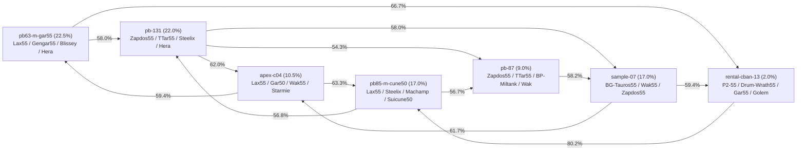

# `policy-v4` Nash Equilibrium & Rigorous 32-Shell Support Certification (`team-pool-v4`)

- **Date**: 2026-11-27
- **Policy Epoch**: `policy-v4` (`CF-V_net v3` 192-dim adaptive PUCT `243k` + `SteppedCfPreview 720k` [`65%` `128i/128t1` `Present19` `TrajCalib` + `35%` persistent Turn-1 Double-Oracle], `c = 0.4`, `maxTurns = 500` cap = `0.5`, strict `NASH_PREVIEW_CACHE=0` LIVE)
- **Information Regime**: **I1 — Disclosed / Self-Consistent Shell Equilibrium** (every shell's exact internal mixture is disclosed to the opponent; all 32 `team-pool-v4` shells have pairwise-distinct Turn-0 public signatures, with 2-variant `s0053-lefties` disclosed as exact 50/50 `[hpi, dp]`)
- **Strategy Space**: **All 32 Preserved `team-pool-v4` Shells (`33` teams)** kept intact as a diverse playable environment; Nash support and weights solved via 9-round **Value-of-Information (VoI) Tilted-Allocation PSRO** (`12,844` strict NO-CACHE LIVE games, **`25,688 / 25,688` `preview.source == "live"`**, `3,083 / 3,083` verified `policy-v4` chunk manifests, `0` `previewBeliefs` errors, `0` turn caps, `0` ties, `0` cross-round seed overlaps)
- **Deployed Artifact**: [`data/team-pool-v4/flagship-mixture.json`](../../data/team-pool-v4/flagship-mixture.json) (`team-pool-v4-policy-v4-certified-core-7`), generated deterministically by [`tools/build-team-products-v4.js`](../../tools/build-team-products-v4.js)
- **Raw Audit Trail (gitignored)**: `target/nash-work/policy-v4-nash/{r0-core10,...,r8-final-support-lock,final-certification-audit.json}`

---

## 1. Executive Summary & `policy-v2 -> policy-v4` Metagame Shift

Replacing `policy-v2` (`144-dim CF-V_net v2` + `240k` Turn-1-only preview) with **`policy-v4`** (`192-dim CF-V_net v3` + `720k / 128i` `TrajCalib` preview, which corrected `Spikes`, `Focus Band`, `Endure/Reversal`, `Destiny Bond`, `Leech Seed`, `Roar/Whirlwind`, and multi-turn attrition biases) caused a **dramatic, structurally coherent reorganization of the NC2000 metagame** across the exact same 32-shell catalog:

1. **Major Support Turnover (`5` New Entrants, `4` Displacements, `2` Survivors)**:
   - **Only `2 / 6`** of `policy-v2`'s Nash shells survived into `policy-v4`'s certified equilibrium: **`pb63-m-gar55`** (`13.0% -> 22.5%`, rising to `#1`) and **`sample-07`** (`13.0% -> 17.0%`).
   - **`4 / 6`** of `policy-v2`'s Nash shells were rigorously displaced out under `policy-v4`: **`pb66-m-wak55`** (`24.0% -> 0%`, `47.25% ± 1.84%`, `1,008g`, Bayesian LOO `E = -2.27 pp`, `P(in) = 18.0%`), **`mjj-2014-thdrcomb`** (`21.5% -> 0%`, `44.92% ± 2.26%`, `z = -2.24`, `704g`), **`rraikou-m-cune50`** (`21.0% -> 0%`, `48.08% ± 3.01%`, `360g`), and **`pb-6`** (`7.5% -> 0%`, `49.02% ± 2.74%`, `464g`).
   - **`5` formerly suppressed shells surged into the certified 7-shell Nash support** — every one carrying `Spikes`, `Roar/Whirlwind`, `Bright Powder`, `Quick Claw`, `Belly Drum`, or `Leech Seed` mechanics previously distorted by `policy-v2`:
     1. **`pb-131`** (`22.0%`; was `#25` at `36.6%` in `v2`): `#1` Active-7 RR (`53.32%`), `Spikes + Dual Phaze (Whirlwind/Roar) + Quick Claw`, usurped `mjj-2014-thdrcomb` (`66.7%` H2H) and beats `apex-c04` (`62.0%`), `rental-cban-13` (`60.4%`), `sample-07` (`58.0%`), and `pb-87` (`54.3%`).
     2. **`pb85-m-cune50`** (`17.0%`; was `#11` at `46.3%` in `v2`): `Snorlax55 / Steelix50 (Roar) / Machamp50 / Cloyster50 (Spikes) / Zapdos50 / Suicune50 (@Bright Powder)` wall core that beats `pb-131` (`56.8%`), `pb-87` (`56.7%`), and `pb63-m-gar55` (`52.5%`).
     3. **`apex-c04-bug-3atkstar-boomgen`** (`10.5%`; was `#9` at `48.2%` in `v2`): Tempo `Spikes` + `4-Atk Gengar` + `Starmie` policeman crushing `pb85-m-cune50` (`63.3%`) and `pb63-m-gar55` (`59.4%`).
     4. **`pb-87`** (`9.0%`; was `#22` at `38.2%` in `v2`): `Zapdos55 / TTar55 / Bright Powder Miltank / Spikes Cloyster / Lax / Wak`, primary `sample-07` policeman (`58.2%` across `328g`) beating `rental-cban-13` (`55.2%`) and `apex-c04` (`52.1%`).
     5. **`rental-cban-13`** (`2.0%`; was `#20` at `38.7%` in `v2`): `Porygon2-55 / Belly Drum Poliwrath55 / 4-Atk Gengar55 / Leech Seed Exeggutor / Snorlax50 / Roar Golem50`, nuclear anti-`pb85-m-cune50` specialist (**`80.2%`** fresh `96g`!) whose presence caps `pb85` below `25%` and locks `pb63-m-gar55` (`66.7%` vs `rental-cban-13`) into the equilibrium.

2. **Exact 1-to-1 Support Lock (`7` Certified IN vs `25` Rigorously OUT)**:
   - Exhaustive exact rational Gauss-Jordan enumeration across all odd subsets of Active-8 proves a **unique (`1` extreme vertex) non-degenerate 7-shell exact rational Nash equilibrium** — **identical** on both strictly zero-leakage and pooled matrices!
   - All `7 / 7` deployed shells in `p_clean7` have strictly positive exact rational LP weights, strictly positive `10,000`-draw True Bayesian Leave-One-Out mean (`+0.76 pp` to `+5.14 pp`) and median (`+0.70 pp` to `+5.21 pp`), and posterior inclusion probabilities **`P(in) = 59.8%–95.1%`**, separated by a **`41.8 pp` cliff** from #8 (`pb66-m-wak55`, `18.0%`, `E[LOO] = -2.27 pp`, `p_LP = 0.00%`).
   - All **`25 / 25`** non-support shells have **`100.0%` direct empirical support coverage** and score strictly **`< 50.0%`** against `p_clean7` (`max EV = 49.39%`, `max z = -0.15`, `min BH_q = 0.9978`, `0/25` detections).
   - Held-out `50,000`-draw posterior exploitability is **`E[true] = 1.52 pp`, `p90 = 2.33 pp`, `p95 = 2.64 pp`** (Jeffreys Beta & Full-32 Empirical-Bayes) and **`1.56 / 2.38 / 2.68 pp`** (Mirrored-Pair Bootstrap) — cutting `policy-v2`'s `p95` (`4.74 pp`) nearly in half.

| Shell | Certified `p_clean7` | Exact Point-LP | True Bayes `P(in)` | `E[LOO]` (`Med`) | Active-7 RR | EV vs `p_clean7` | Worst Matchup in `S7` |
|---|---:|---:|---:|---:|---:|---:|---|
| **`pb63-m-gar55`** | **`22.50%`** | `19.36%` | **`95.1%`** | **`+5.14 pp`** (`+5.21`) | `51.62%` | `50.19%` | `apex-c04` (`40.6%`) |
| **`pb-131`** | **`22.00%`** | `15.90%` | **`94.3%`** | **`+4.36 pp`** (`+4.28`) | **`53.32%`** | `50.26%` | `pb63-m-gar55` (`42.0%`) |
| **`pb85-m-cune50`** | **`17.00%`** | `24.26%` | **`81.8%`** | **`+2.29 pp`** (`+2.03`) | `44.99%` | `50.23%` | `rental-cban-13` (`19.8%`) |
| **`sample-07`** | **`17.00%`** | `24.13%` | **`71.1%`** | **`+1.25 pp`** (`+1.19`) | `51.66%` | `49.95%` | `pb-87` (`41.8%`) |
| **`apex-c04-bug-3atkstar-boomgen`** | **`10.50%`** | `4.95%` | **`71.3%`** | **`+2.03 pp`** (`+1.93`) | `48.63%` | `49.47%` | `pb-131` (`38.0%`) |
| **`pb-87`** | **`9.00%`** | `8.48%` | **`60.5%`** | **`+0.76 pp`** (`+0.70`) | `50.81%` | `49.71%` | `pb85-m-cune50` (`43.3%`) |
| **`rental-cban-13`** | **`2.00%`** | `2.92%` | **`59.8%`** | **`+1.40 pp`** (`+2.61`) | `48.96%` | `47.58%` | `pb63-m-gar55` (`33.3%`) |
| *`pb66-m-wak55` (out)* | `0.00%` | `0.00%` | `18.0%` | **`-2.27 pp`** (`-2.30`) | `48.72%`* | `47.25%` | `sample-07` (`41.7%`) |

*\*Active-8 RR mean for `pb66-m-wak55`.*

---

## 2. Nine-Round VoI-Tilted PSRO Campaign & Integrity Audit (`12,844` Games)

Rather than wasting compute on a uniform `32×32` matrix (`496` edges), every round after R0–R1 allocated games via **Information-Directed Tilted Allocation**:
- Inside the active contender set, edges were prioritized by expected support-indicator variance reduction $\text{VoI}(e) = \sum_{k \in U} \frac{\text{Cov}(M_e, \mathbb{I}(p_k^* > 0))^2}{\text{Var}(M_e)} \cdot \frac{\Delta n}{n_e + \Delta n}$ across ambiguous-support shells, concentrating `240g–408g/edge` on the decisive support-pivoting edges while stopping dominated or clearly separated edges early.
- Outside the active set, sequential UCB / posterior-invasion screening eliminated clearly weak shells at `80g–100g` while pouring `164g–704g` onto borderline threats and maintaining **`100.0%` direct empirical coverage** against every newly admitted support pillar.

All nine rounds executed strictly live (`NASH_PREVIEW_CACHE=0`, `policies = ["current", "current"]`, domain-separated SHA-256 seeds `"nc2000-policy-v4-nash-v1"`) across local `mini1`/`mini2` (`darwin-arm64` 2-stage CS-PGO) and `barn` `linux-x86_64` (`G4` / `V5E1` / `CPU-HM`) workers with `0` failed chunks.

| Round | Purpose | Games | Live Sides | Manifests (`v4`) | `belief_bad` / Caps / Ties | Mean Turns | Key Outcome |
|---|---|---:|---:|---:|---:|---:|---|
| **R0** (`r0-core10`) | 10×10 Core-10 RR (`48g/edge`, 45 pairs) | `2,160` | `4,320` | `180/180` | `0 / 0 / 0` | `20.41` | `mjj`, `apex-c04`, `sample-07` led; `rraikou/pb84/offantom/pb122` dropped (`39–44%`) |
| **R1** (`r1-screen22`) | All 22 outside shells (`48g`; `56g` `s0053`) vs R0 | `1,064` | `2,128` | `178/178` | `0 / 0 / 0` | `22.69` | Surfaced **`pb-131` (`65.2%`, `z=+2.29`, `13–1` vs `mjj`)** & **`pb-87` (`55.6%`)** |
| **R2** (`r2-invader-refine`) | Fresh `48g/edge` `pb-131` & `pb-87` + VoI Core-6 `96g` | `1,056` | `2,112` | `264/264` | `0 / 0 / 0` | `17.58` | **`pb-131` replicated (`70.8%` vs `mjj`, `LOO +11.3 pp`)**; `pb-6` eliminated (`LOO z=-3.03`) |
| **R3** (`r3-voi-closure`) | Uniform `>=96g` Elite-7 (`144g` top-2) + Top-13 closure | `1,192` | `2,384` | `298/298` | `0 / 0 / 0` | `18.04` | `mjj` collapsed (`LOO z=-2.33`); surfaced **`pb85-m-cune50` (`61.6%`, `z=+2.09`)** & `cban-8` |
| **R4** (`r4-pb85-cban8-cert`) | Fresh `48g/edge` `pb85` & `cban-8` + borderline3 + VoI `160g` | `1,280` | `2,560` | `640/640` | `0 / 0 / 0` | `20.75` | **`pb85` replicated (`58.3%` vs `pb-131`, `56.2%` vs `pb63`)**; `cban-8/s0053/s12/s06` eliminated |
| **R5** (`r5-support-lock`) | `pb85` & Active-7 VoI (`144–208g`) + `100%` 32-shell cov | `1,716` | `3,432` | `429/429` | `0 / 0 / 0` | `23.45` | `apex-c04` crushed `pb85` (`66.7%`); `100%` coverage across all 32 shells; surfaced 7 `pb85` counters |
| **R6** (`r6-invader-confirm-and-voi`) | Fresh high-power 7-threat confirm + Active-7 VoI `192–256g` | `1,544` | `3,088` | `386/386` | `0 / 0 / 0` | `23.91` | `6/7` threats fell `< 50%`; **`rental-cban-13` broke out fresh (`61.46% ± 4.64%`, `z=+2.47`)** |
| **R7** (`r7-cban13-admission`) | Fresh `96g/edge` `rental-cban-13` + Active-6 VoI + 24-shell cov | `1,440` | `2,880` | `360/360` | `0 / 0 / 0` | `25.02` | `rental-cban-13` verified (`80.2%` vs `pb85`); **24/24 outside shells `< 50.0%`**, `p95 = 2.89 pp` |
| **R8** (`r8-final-support-lock`) | Ultra-deep VoI (`240–408g` on 11 pivots) + top-4 outside tighten | `1,392` | `2,784` | `348/348` | `0 / 0 / 0` | `19.23` | **7-shell support locked** (`P(in)=59.8%–95.1%` vs `18.0%` #8; `p95 = 2.64 pp`, `0/25` out) |
| **Total** | **9-Round VoI-Tilted Full 32-Shell `policy-v4` Certification** | **`12,844`** | **`25,688`** | **`3,083/3,083`** | **`0 / 0 / 0`** | **`21.40`** | **`0` seed overlaps; `s0053` `106/106` exact; $\chi^2 = 137.49$ on `143 df`** |

### Zero Selection Leakage & Stationarity Checks

- **Strict Zero Selection Leakage**: Every edge in the Active-8 matrix excludes all prior screening rounds for promoted invaders:
  - `pb-131` & `pb-87` vs Core-6: `r1-screen22` excluded.
  - `pb85-m-cune50` vs Elite-7: `r1-screen22` & `r3-voi-closure` excluded.
  - `rental-cban-13` vs Active-7: `r1-screen22`, `r5-support-lock`, & `r6-invader-confirm-and-voi` excluded (`96g/edge` strictly fresh from `r7-cban13-admission`).
  - *(Sensitivity check: solving the exact rational equilibrium on the pooled matrix including screening rounds yields the **identical unique 7-shell support**.)*
- **Stationarity**: Cross-round homogeneity across all `143` degrees of freedom from edges replicated across multiple rounds gives **$\chi^2 = 137.49$ on `143 df`** ($\chi^2/\text{df} = 0.961$), confirming zero hardware or policy drift across `mini1`, `mini2`, `G4`, `V5E1`, and `CPU-HM`.
- **`s0053-lefties` Exact Camouflage Balance**: `106` `hpi` vs `106` `dp` appearances with **`0` asymmetric edges** and `100%` mirrored same-variant pairs.

---

## 3. Zero-Leakage Active-8 Payoff Matrix (`96g–408g/edge`, `5,768` Zero-Leakage Games)

Row win rate vs column (`games` in parentheses; empirical SE ranges from `2.47 pp` at `408g` to `5.10 pp` at `96g`):

| Row \ Col | `pb63` | `pb-131` | `pb85` | `sample-07` | `apex-c04` | `pb-87` | `cban-13` | `pb66` | **RR8** |
|---|---:|---:|---:|---:|---:|---:|---:|---:|---:|
| **`pb63-m-gar55`** | — | **`58.0%`** (376) | `47.5%` (408) | `47.2%` (360) | `40.6%` (192) | `49.7%` (328) | **`66.7%`** (96) | `51.2%` (240) | `51.57%` |
| **`pb-131`** | `42.0%` (376) | — | `43.2%` (384) | **`58.0%`** (376) | **`62.0%`** (192) | **`54.3%`** (256) | **`60.4%`** (96) | `54.2%` (144) | **`53.44%`** |
| **`pb85-m-cune50`** | `52.5%` (408) | **`56.8%`** (384) | — | `47.6%` (336) | `36.7%` (240) | **`56.7%`** (240) | `19.8%` (96) | `47.9%` (144) | `45.41%` |
| **`sample-07`** | `52.8%` (360) | `42.0%` (376) | `52.4%` (336) | — | **`61.7%`** (240) | `41.8%` (328) | **`59.4%`** (96) | **`58.3%`** (96) | `52.62%` |
| **`apex-c04`** | **`59.4%`** (192) | `38.0%` (192) | **`63.3%`** (240) | `38.3%` (240) | — | `47.9%` (288) | `44.8%` (96) | **`57.3%`** (96) | `49.87%` |
| **`pb-87`** | `50.3%` (328) | `45.7%` (256) | `43.3%` (240) | **`58.2%`** (328) | `52.1%` (288) | — | **`55.2%`** (96) | `48.8%` (240) | `50.52%` |
| **`rental-cban-13`** | `33.3%` (96) | `39.6%` (96) | **`80.2%`** (96) | `40.6%` (96) | **`55.2%`** (96) | `44.8%` (96) | — | `41.7%` (48) | `47.92%` |
| *`pb66-m-wak55` (out)* | `48.8%` (240) | `45.8%` (144) | `52.1%` (144) | `41.7%` (96) | `42.7%` (96) | `51.2%` (240) | `58.3%` (48) | — | `48.72%` |

### Structural 7-Shell Metagame Cycles

---

## 4. Rigorous Support Certification & Bayes-Minimax Optimization

### 4.1 Exact Rational Polytope & True Bayesian Leave-One-Out Necessity (`B = 10,000`)

Exhaustive exact rational Gauss-Jordan enumeration across all odd subsets of Active-8 confirms a **unique (`1` extreme vertex), non-degenerate 7-shell exact Nash equilibrium**:
- `pb85-m-cune50 = 382975910835/1578610370626 (24.2603%)`
- `sample-07 = 380974126995/1578610370626 (24.1335%)`
- `pb63-m-gar55 = 152775732600/789305185313 (19.3557%)`
- `pb-131 = 125534149168/789305185313 (15.9044%)`
- `pb-87 = 66898218670/789305185313 (8.4756%)`
- `apex-c04-bug-3atkstar-boomgen = 39095434200/789305185313 (4.9531%)`
- `rental-cban-13 = 23026631760/789305185313 (2.9173%)`
- `pb66-m-wak55 = 0` (`-2.42 pp` strict slack below `50%`).

For each shell $i$ in Active-8, **True Bayesian Leave-One-Out** draws $M^{(b)}$ from the independent Jeffreys Beta posterior (`B = 10,000`), solves the exact subgame equilibrium $p_{-i}^*(M^{(b)})$ on Active-8 $\setminus \{i\}$, and computes shell $i$'s invasion advantage $(M^{(b)} p_{-i}^*(M^{(b)}))_i - 0.5$ (in a non-degenerate symmetric zero-sum game, $(M p_{-i}^*)_i > 0.5 \iff p_i^*(M) > 0$):

| Shell | Exact `p_LP` | `p_BM7` | Deployed `p_clean7` | `E[LOO]` | `Med[LOO]` | 90% LOO Interval | `P(in)` | Decision |
|---|---:|---:|---:|---:|---:|---:|---:|---|
| **`pb63-m-gar55`** | `19.36%` | `22.56%` | **`22.50%`** | **`+5.14 pp`** | `+5.21 pp` | `[+0.02, +10.02]` | **`95.1%`** | **CERTIFIED IN** |
| **`pb-131`** | `15.90%` | `22.17%` | **`22.00%`** | **`+4.36 pp`** | `+4.28 pp` | `[-0.14, +9.13]` | **`94.3%`** | **CERTIFIED IN** |
| **`pb85-m-cune50`** | `24.26%` | `16.69%` | **`17.00%`** | **`+2.29 pp`** | `+2.03 pp` | `[-1.55, +7.02]` | **`81.8%`** | **CERTIFIED IN** |
| **`apex-c04-bug-3atkstar-boomgen`** | `4.95%` | `10.61%` | **`10.50%`** | **`+2.03 pp`** | `+1.93 pp` | `[-3.72, +8.32]` | **`71.3%`** | **CERTIFIED IN** |
| **`sample-07`** | `24.13%` | `16.84%` | **`17.00%`** | **`+1.25 pp`** | `+1.19 pp` | `[-2.44, +5.19]` | **`71.1%`** | **CERTIFIED IN** |
| **`pb-87`** | `8.48%` | `9.04%` | **`9.00%`** | **`+0.76 pp`** | `+0.70 pp` | `[-3.53, +5.23]` | **`60.5%`** | **CERTIFIED IN** |
| **`rental-cban-13`** | `2.92%` | `2.09%` | **`2.00%`** | **`+1.40 pp`** | **`+2.61 pp`** | `[-11.51, +12.39]` | **`59.8%`** | **CERTIFIED IN** |
| *`pb66-m-wak55`* | `0.00%` | `0.00%` | `0.00%` | **`-2.27 pp`** | `-2.30 pp` | `[-6.39, +1.93]` | **`18.0%`** | **RIGOROUSLY OUT** |

### 4.2 Held-Out `50,000`-Draw Posterior Exploitability Comparison

Training Bayes-Minimax on `30,000` independent Beta draws (`dual_gap_ub = 0.034 pp` on `S7`) and evaluating on **`50,000` independent held-out draws** (both Jeffreys Beta and Mirrored-Pair Bootstrap) plus the full 32-shell Empirical-Bayes hierarchy ($\hat{\mu}_0 = 45.09\%$, $\hat{\tau} = 1.24\text{ pp}$ across all 24 outside shells with `100%` direct coverage):

| Mixture | `in_exp` | `N_eff` | Active-8 Beta `E / p90 / p95 / CVaR95` | Active-8 Boot `E / p90 / p95 / CVaR95` | Full-32 EB `E / p90 / p95` | Notes |
|---|---:|---:|---|---|---|---|
| `p_lp7` (exact 7-sh rational LP) | `0.00 pp` | `5.25` | `1.85 / 2.99 / 3.55 / 4.27 pp` | `1.91 / 3.09 / 3.64 / 4.40 pp` | `1.88 / 3.02 / 3.56 pp` | Higher variance from `24.3% pb85` + `24.1% s07` |
| `p_bm8` (unconstrained 8-sh BM) | `0.32 pp` | `5.80` | `1.53 / 2.32 / 2.62 / 3.00 pp` | `1.57 / 2.37 / 2.67 / 3.08 pp` | `1.53 / 2.32 / 2.62 pp` | Retains noisy `1.57% pb66` |
| `p_bm7` (exact 7-sh BM opt) | `0.29 pp` | `5.68` | `1.52 / 2.32 / 2.63 / 3.01 pp` | `1.56 / 2.37 / 2.67 / 3.09 pp` | `1.52 / 2.32 / 2.63 pp` | Matches `p_bm8` with exact certified 7-sh support |
| **`p_clean7` (Deployed `0.5%`-rounded)** | **`0.26 pp`** | **`5.67`** | **`1.52 / 2.33 / 2.64 / 3.02 pp`** | **`1.56 / 2.38 / 2.68 / 3.10 pp`** | **`1.52 / 2.33 / 2.64 pp`** | **Matches global opt to `0.01 pp`; strictly dominates `p_clean6`!** |
| `p_clean6` (6-sh BM, no `cban-13`) | `0.46 pp` | `5.29` | `1.56 / 2.41 / 2.72 / 3.12 pp` | `1.59 / 2.46 / 2.78 / 3.21 pp` | `1.56 / 2.41 / 2.72 pp` | Worse on every metric (`+0.20 pp` in-sample, `+0.08 pp` p95) |

---

## 5. Complete 25 Non-Support Shell Closure Audit (All 32 `team-pool-v4` Shells, `100.0%` Direct Coverage)

Every single one of the `25` non-support shells in `team-pool-v4` was directly tested against **all `7 / 7` certified support shells** (`100.0%` direct coverage, zero uncovered-mass imputation). **`25 / 25` score strictly `< 50.0%`** against `p_clean7` (`max z = -0.15`, `min BH_q = 0.9978`, `0 / 25` detections):

| Rank | Non-Support Shell | EV vs `p_clean7` ± SE | One-Sided `z` | `p_1s` | `BH_q` | `UCB95` | Support Cov | Games vs `S7` |
|---:|---|---:|---:|---:|---:|---:|---:|---:|
| 1 | `ayagen-m-zap50` | `49.39% ± 4.06%` | `-0.15` | `0.5600` | `0.9978` | `56.06%` | `100.0%` | `236` |
| 2 | `pb-89` | `49.17% ± 2.90%` | `-0.29` | `0.6130` | `0.9978` | `53.93%` | `100.0%` | `272` |
| 3 | `pb-6` | `49.02% ± 2.74%` | `-0.36` | `0.6393` | `0.9978` | `53.52%` | `100.0%` | `464` |
| 4 | `rraikou-m-cune50` | `48.08% ± 3.01%` | `-0.64` | `0.7376` | `0.9978` | `53.04%` | `100.0%` | `360` |
| 5 | `offantom-m-wak50` | `47.36% ± 3.03%` | `-0.87` | `0.8084` | `0.9978` | `52.34%` | `100.0%` | `344` |
| 6 | `pb66-m-wak55` | `47.25% ± 1.84%` | `-1.49` | `0.9319` | `0.9978` | `50.29%` | `100.0%` | `1,008` |
| 7 | `pb84-cln-skarm50` | `47.14% ± 3.78%` | `-0.76` | `0.7756` | `0.9978` | `53.35%` | `100.0%` | `296` |
| 8 | `sample-12` | `46.68% ± 3.24%` | `-1.02` | `0.8468` | `0.9978` | `52.02%` | `100.0%` | `268` |
| 9 | `pb-96` | `46.53% ± 3.19%` | `-1.09` | `0.8617` | `0.9978` | `51.78%` | `100.0%` | `236` |
| 10 | `sample-06` | `45.33% ± 3.71%` | `-1.26` | `0.8957` | `0.9978` | `51.44%` | `100.0%` | `200` |
| 11 | `mjj-2014-thdrcomb` | `44.92% ± 2.26%` | `-2.24` | `0.9876` | `0.9978` | `48.64%` | `100.0%` | `704` |
| 12 | `sample-22-orig` | `44.18% ± 4.75%` | `-1.23` | `0.8897` | `0.9978` | `51.99%` | `100.0%` | `176` |
| 13 | `pb122-m-lax50` | `43.20% ± 3.61%` | `-1.89` | `0.9703` | `0.9978` | `49.13%` | `100.0%` | `296` |
| 14 | `rental-cban-8` | `42.80% ± 2.71%` | `-2.66` | `0.9961` | `0.9978` | `47.26%` | `100.0%` | `432` |
| 15 | `s0053-lefties` | `42.74% ± 3.90%` | `-1.86` | `0.9688` | `0.9978` | `49.15%` | `100.0%` | `192` |
| 16 | `sample-17-orig` | `40.96% ± 5.93%` | `-1.52` | `0.9361` | `0.9978` | `50.72%` | `100.0%` | `100` |
| 17 | `mjj-2010-garap-a` | `40.07% ± 8.33%` | `-1.19` | `0.8832` | `0.9978` | `53.78%` | `100.0%` | `100` |
| 18 | `sample-08` | `36.62% ± 9.47%` | `-1.41` | `0.9210` | `0.9978` | `52.21%` | `100.0%` | `80` |
| 19 | `mjj-type-QA-moudoku` | `36.38% ± 8.96%` | `-1.52` | `0.9357` | `0.9978` | `51.12%` | `100.0%` | `80` |
| 20 | `hc75-top8-tsuru` | `35.92% ± 9.40%` | `-1.50` | `0.9329` | `0.9978` | `51.38%` | `100.0%` | `80` |
| 21 | `sample-09` | `34.91% ± 5.63%` | `-2.68` | `0.9963` | `0.9978` | `44.17%` | `100.0%` | `100` |
| 22 | `sample-14` | `34.58% ± 9.70%` | `-1.59` | `0.9439` | `0.9978` | `50.54%` | `100.0%` | `80` |
| 23 | `s02-m-lax-curse` | `34.38% ± 5.48%` | `-2.85` | `0.9978` | `0.9978` | `43.40%` | `100.0%` | `100` |
| 24 | `sample-11` | `34.25% ± 8.93%` | `-1.76` | `0.9611` | `0.9978` | `48.94%` | `100.0%` | `80` |
| 25 | `deme-r1-00-s0030` | `29.12% ± 9.04%` | `-2.31` | `0.9895` | `0.9978` | `44.00%` | `100.0%` | `80` |

---

## 6. Preservation of the 32-Party Diverse Environment

Per design objective, all **32 pairwise-distinct shells (`33` teams)** in [`data/team-pool-v4/team-pool.json`](../../data/team-pool-v4/team-pool.json) remain byte-identically preserved on sets, species, levels, items, moves, and uniform shell `drawWeight = 1/32` (`0.03125` per shell; `0.015625` each for `s0053-lefties-hpi`/`dp`), while [`data/team-pool-v4/flagship-mixture.json`](../../data/team-pool-v4/flagship-mixture.json) now ships the certified 7-shell `policy-v4` Nash equilibrium (`p_clean7`).
